<a href="https://gourabroy551.github.io/">
  <picture>
    <source media="(prefers-color-scheme: dark)" srcset="assets/header-dark.svg"/>
    <source media="(prefers-color-scheme: light)" srcset="assets/header-light.svg"/>
    
  </picture>
</a>

  <a href="https://gourabroy551.github.io/">Portfolio</a>&nbsp;&nbsp;·&nbsp;&nbsp;<a href="https://scholar.google.com/citations?user=_9tL56YAAAAJ">Google Scholar</a>&nbsp;&nbsp;·&nbsp;&nbsp;<a href="https://www.linkedin.com/in/gourab-roy-5b52921a3/">LinkedIn</a>&nbsp;&nbsp;·&nbsp;&nbsp;<a href="https://www.kaggle.com/gourabroy553">Kaggle</a>&nbsp;&nbsp;·&nbsp;&nbsp;<a href="mailto:gourabroysec553@gmail.com">gourabroysec553@gmail.com</a>

 

### About

I'm an ML researcher studying in the **Erasmus Mundus Joint Master's in AI for Image Processing & Computer Vision**. The program moves through Budapest, Madrid and now **Bordeaux**. I work on **explainable AI** for vision and vision–language models, **medical image analysis**, and **trustworthy, reproducible deep learning**.

Before the master's I spent two years as a **research assistant** and taught as an **adjunct lecturer** at Sylhet Engineering College in Bangladesh. That work led to **12 peer-reviewed papers**. I also review for *Informatics in Medicine Unlocked*.

> **Looking for:** a 5–6 month on-site research internship starting **1 February 2027**, in a lab where I can run careful experiments and contribute to a publication.

 

### Selected work

  <a href="https://github.com/GourabRoy551/banglacaption40k-xai-retrieval-benchmark"><picture><source media="(prefers-color-scheme: light)" srcset="assets/cards/banglacaption40k-light.svg"/></picture></a>
  <a href="https://github.com/GourabRoy551/Clip-Soft-Prefix-Retrieval-Attribution"><picture><source media="(prefers-color-scheme: light)" srcset="assets/cards/clip-soft-prefix-light.svg"/></picture></a>
  <a href="https://github.com/zunaaaaayed/SiteGuard-AI"><picture><source media="(prefers-color-scheme: light)" srcset="assets/cards/siteguard-ai-light.svg"/></picture></a>
  <a href="https://github.com/GourabRoy551/Calibrated-Multi-View-3D-Reconstruction"><picture><source media="(prefers-color-scheme: light)" srcset="assets/cards/multiview-3d-light.svg"/></picture></a>
  <a href="https://github.com/GourabRoy551/cardiac-autonomic-ppg-hrv"><picture><source media="(prefers-color-scheme: light)" srcset="assets/cards/ppg-hrv-light.svg"/></picture></a>
  <picture><source media="(prefers-color-scheme: light)" srcset="assets/cards/cerebralnet-light.svg"/></picture>

Also built: <a href="https://github.com/GourabRoy551/Pioneer_Bank_Complete">Pioneer Bank</a>, a vanilla-JS banking dashboard, and <a href="https://github.com/GourabRoy551/BillingSystem">Billing System</a>, a Java Swing point-of-sale app.

 

### Path

**Université de Bordeaux** · Erasmus Mundus IPCVAI&nbsp;&nbsp;`2026 – now` 
Explainable AI for Images · Advanced Computer Vision · Acquisition, Reconstruction & Medical Imaging

**Universidad Autónoma de Madrid** · Erasmus Mundus IPCVAI&nbsp;&nbsp;`2026` 
Deep Learning for Computer Vision · HPC for Deep Learning · Vision for Multiple & Moving Cameras

**Pázmány Péter Catholic University** · Erasmus Mundus IPCVAI&nbsp;&nbsp;`2025` 
Image Processing · Fundamentals of Deep Learning · Multimodal Sensor Fusion · Biomedical Signal Processing

**Sylhet Engineering College** · Research Assistant & Adjunct Lecturer&nbsp;&nbsp;`2023 – 2025` 
Medical AI, document AI, agricultural vision and NLP research, which led to 12 papers · Taught Data Science, Distributed Computing and Computer Architecture

**Sylhet Engineering College** · B.Sc. Computer Science & Engineering&nbsp;&nbsp;`2018 – 2023` 
Thesis: *CerebralNet*, detecting major abnormalities in brain CT and MRI scans

 

### Publications

12 peer-reviewed papers. A selection is below, and the full list is on [Google Scholar](https://scholar.google.com/citations?user=_9tL56YAAAAJ).

<b>Journal articles</b>

 

- **CovidExpert**: a triplet Siamese network for COVID-19 detection. *Informatics in Medicine Unlocked*, 2023. [doi](https://doi.org/10.1016/j.imu.2022.101156)
- **Bangladeshi rice varieties**: image-based classification with deep CNNs. *Agricultural Products Processing and Storage*, 2026. [doi](https://doi.org/10.1007/s44462-026-00061-9)
- **BanglaFont45**: font detection and classification with ML and transfer learning. *Journal of Computer Sciences Institute*, 2025. [doi](https://doi.org/10.35784/jcsi.7120)
- **Syloti Nagri OCR**: deep-learning OCR for an ancient script. *Journal of Computer Sciences Institute*, 2025. [doi](https://doi.org/10.35784/jcsi.6785)

<b>IEEE conference papers</b>

 

- **PlantXNet**: explainable multi-plant leaf disease classification with LIME. *IEEE QPAIN*, 2026. [doi](https://doi.org/10.1109/QPAIN69676.2026.11545914)
- **MaizeXNet**: explainable maize pest and disease classification. *IEEE QPAIN*, 2026. [doi](https://doi.org/10.1109/QPAIN69676.2026.11546210)
- **PoultryXNet**: explainable poultry disease classification from fecal images. *IEEE QPAIN*, 2026. [doi](https://doi.org/10.1109/QPAIN69676.2026.11545990)
- **DateFNet**: attention-based multi-stream CNN for date fruit classification. *IEEE ICCIT*, 2025. [doi](https://doi.org/10.1109/ICCIT68739.2025.11491249)
- **Concrete tensile strength**: ML models for prediction and classification. *IEEE ECCE*, 2025. [doi](https://doi.org/10.1109/ECCE64574.2025.11013991)
- **CrackClassification4**: four types of structural surface cracks with CNNs. *IEEE ICCIT*, 2024. [doi](https://doi.org/10.1109/ICCIT64611.2024.11022574)
- **Multilingual summarization**: corpus creation and filtering. *IEEE ICCIT*, 2024. [doi](https://doi.org/10.1109/ICCIT64611.2024.11022549)

 

### Toolkit

<picture>
  <source media="(prefers-color-scheme: light)" srcset="https://skillicons.dev/icons?i=py%2Cpytorch%2Ctensorflow%2Csklearn%2Copencv%2Cc%2Ccpp%2Cmatlab%2Cjava%2Cts%2Cfastapi%2Cdocker%2Cgit%2Clinux%2Clatex&theme=light&perline=15"/>
  
</picture>

**Models:** CNNs · ViT · CLIP · BERT · YOLO&nbsp;&nbsp;·&nbsp;&nbsp;**XAI:** attention rollout · SHAP · LIME&nbsp;&nbsp;·&nbsp;&nbsp;**Science:** NumPy · SciPy · Pandas · Matplotlib · Jupyter

 

### Activity

  
  

<picture>
  <source media="(prefers-color-scheme: dark)" srcset="https://raw.githubusercontent.com/GourabRoy551/GourabRoy551/output/snake-dark.svg"/>
  <source media="(prefers-color-scheme: light)" srcset="https://raw.githubusercontent.com/GourabRoy551/GourabRoy551/output/snake-light.svg"/>
  
</picture>

 

  <a href="https://codeforces.com/profile/gourab_roy">Codeforces</a>&nbsp;·&nbsp;<a href="https://www.hackerrank.com/profile/bdgourab5184">HackerRank</a>&nbsp;·&nbsp;<a href="https://uhunt.onlinejudge.org/id/983508">UVa</a>&nbsp;·&nbsp;<a href="https://www.coursera.org/account/accomplishments/specialization/PZVVNHLFTBU3">Coursera ML</a>&nbsp;·&nbsp;<a href="https://twitter.com/gourab553">X</a>&nbsp;·&nbsp;<a href="https://discord.gg/xrs_gourab">Discord</a>&nbsp;·&nbsp;<a href="https://www.instagram.com/gourab6740/">Instagram</a>&nbsp;·&nbsp;<a href="https://www.facebook.com/bdgourab5184">Facebook</a>
    
  Sylhet → Budapest → Madrid → Bordeaux

